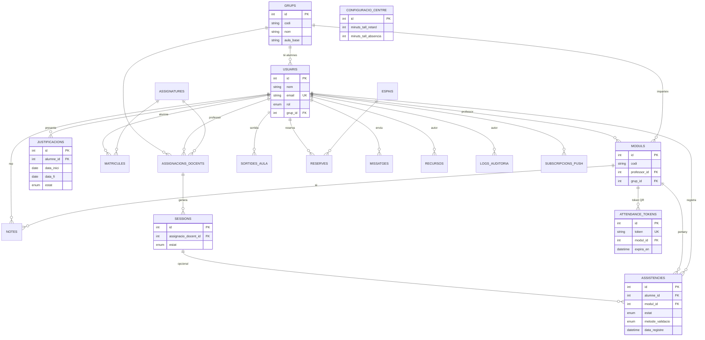
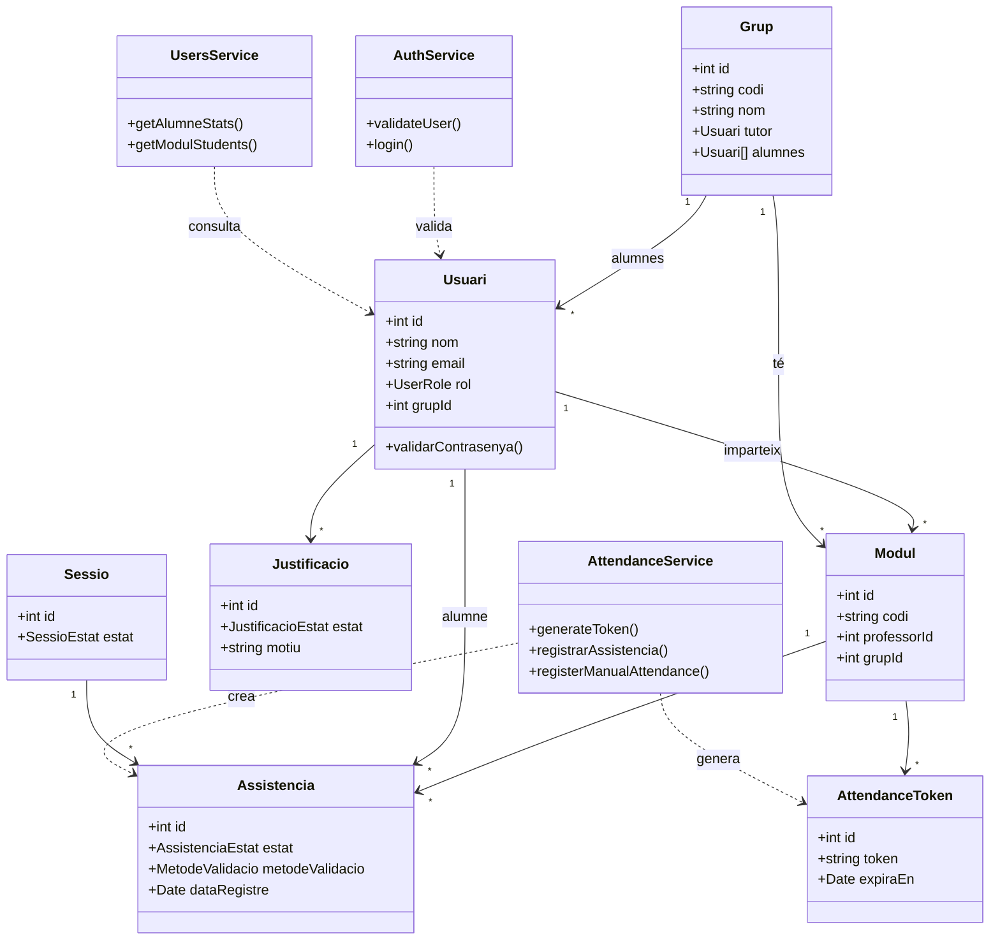
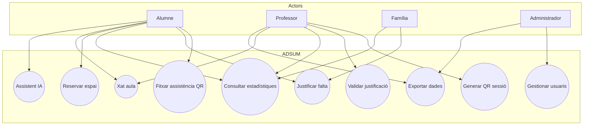
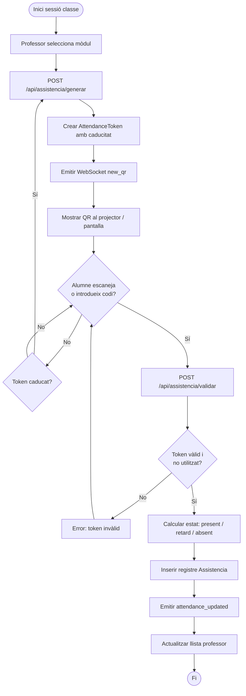
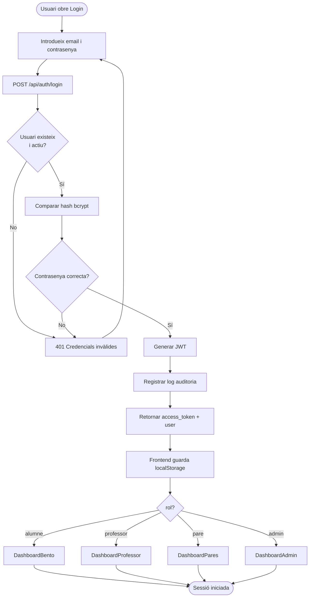
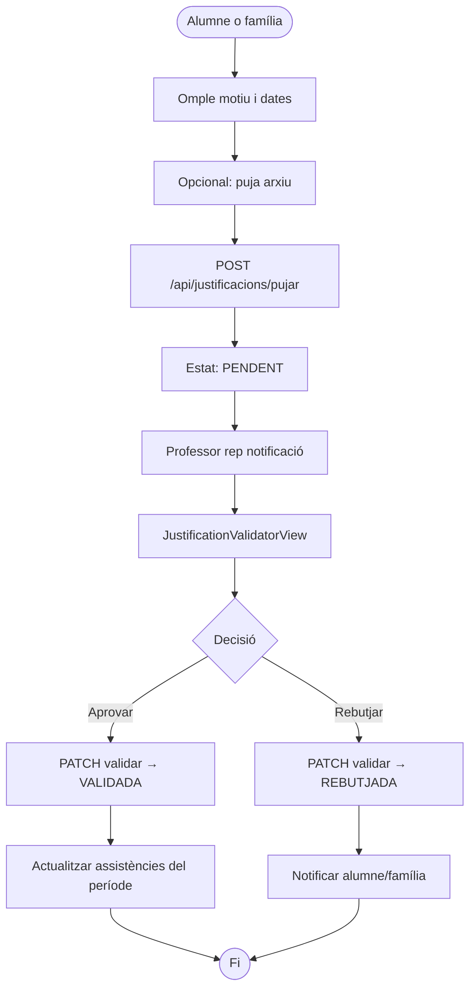
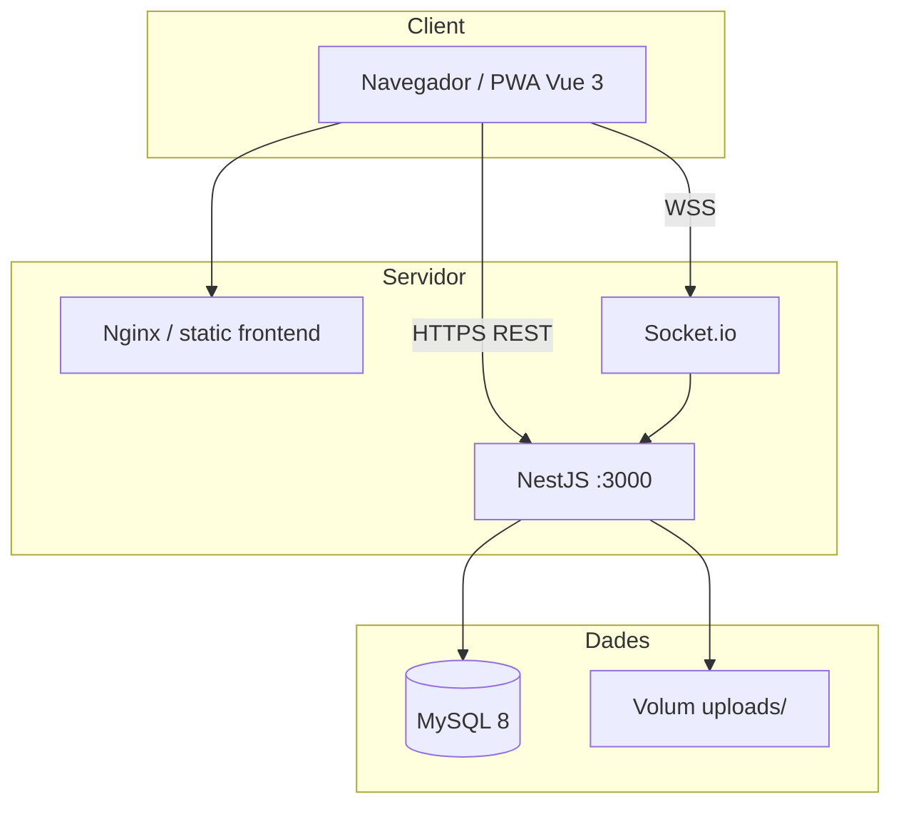
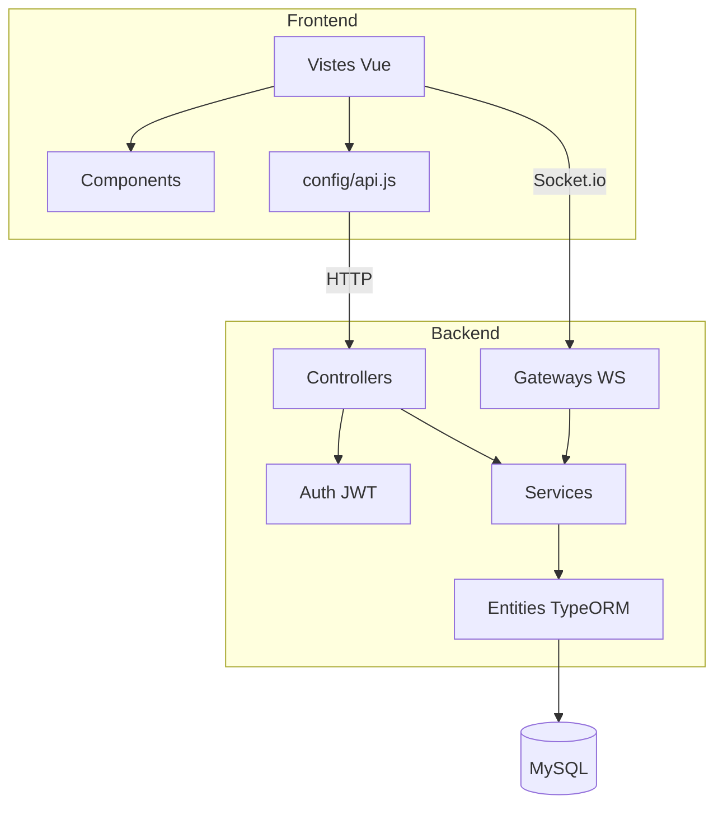

# Diagrames UML i E/R

Diagramas del model de dades i del comportament del sistema ADSUM. Es poden visualitzar directament a GitHub, GitLab o qualsevol visor compatible amb **Mermaid**.

Veure també: [base-de-dades.md](base-de-dades.md) · [arquitectura.md](arquitectura.md)

---

## 1. Diagrama entitat-relació (E/R)

Model simplificat de les taules principals i les seves cardinalitats.

### Taules auxiliars (resum)

| Taula | Relació principal |
|-------|-------------------|
| `assignatures` | Catàleg de matèries |
| `matricules` | N:M alumne ↔ assignatura |
| `horaris` | Franja horària per mòdul |
| `espais` / `reserves` | Reserva de sales |
| `recursos` | Repositori de fitxers |
| `missatges` | Xat per sales |
| `dispositius` | Dispositius de l'usuari |
| `logs_auditoria` | Traça d'accions |

Esquema SQL complet: [`../schema.sql`](../schema.sql).

---

## 2. Diagrama de classes (domini principal)

Classes del backend (`backend/src/entities/`) i serveis associats.

### Enumeracions rellevants

| Enum | Valors | Ús |
|------|--------|-----|
| `UserRole` | admin, professor, alumne, familia | RBAC |
| `AssistenciaEstat` | present, retard, absent, justificat | Fitxatge |
| `MetodeValidacio` | qr_mobil, professor_manual, pin_manual, targeta_nfc | Origen del registre |
| `JustificacioEstat` | pendent, validada, rebutjada | Workflow justificacions |

---

## 3. Diagrama de casos d'ús

---

## 4. Diagrama d'activitats — Fitxatge amb QR dinàmic

Flux principal del projecte (professor → alumne → base de dades).

---

## 5. Diagrama d'activitats — Autenticació (login)

---

## 6. Diagrama d'activitats — Justificació de falta

---

## 7. Diagrama de desplegament

---

## 8. Diagrama de components (arquitectura lògica)

---

## Eines recomanades per exportar

| Eina | Ús |
|------|-----|
| [Mermaid Live Editor](https://mermaid.live) | Exportar PNG/SVG dels diagrames |
| draw.io / diagrams.net | Editar E/R si cal més detall |
| Swagger UI | Documentació API (`/api/docs`) |
| MySQL Workbench | Reverse engineering des de `schema.sql` |

---

## Relació amb la implementació

| Diagrama | Codi de referència |
|----------|-------------------|
| E/R | `schema.sql`, `backend/src/entities/` |
| Classes | `*.entity.ts`, `*.service.ts` |
| Activitat QR | `attendance.service.ts`, `attendance.gateway.ts` |
| Activitat login | `auth.service.ts`, `Login.vue` |
| Casos d'ús | `App.vue`, `AppShell.vue` |
| Flux pantalles | [mockups-wireframes.md](mockups-wireframes.md) |
