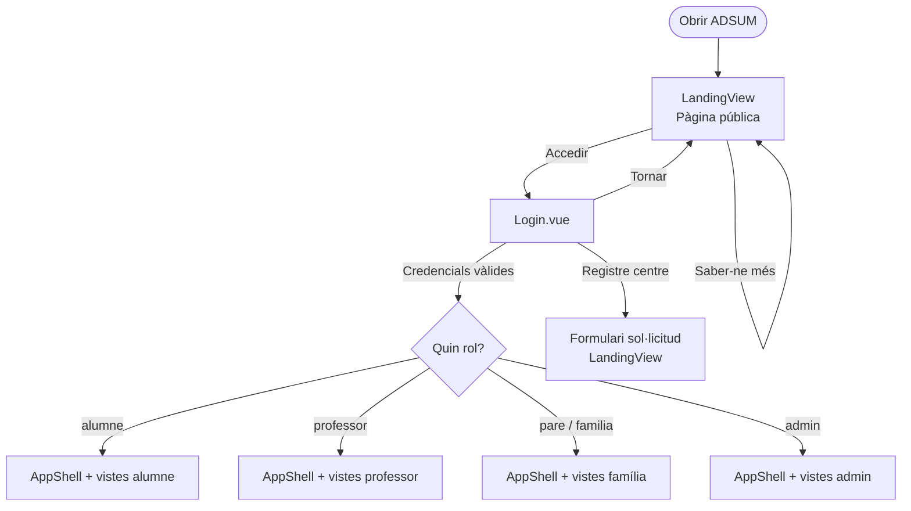
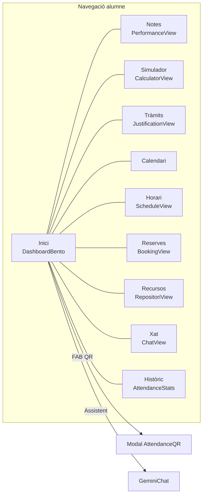
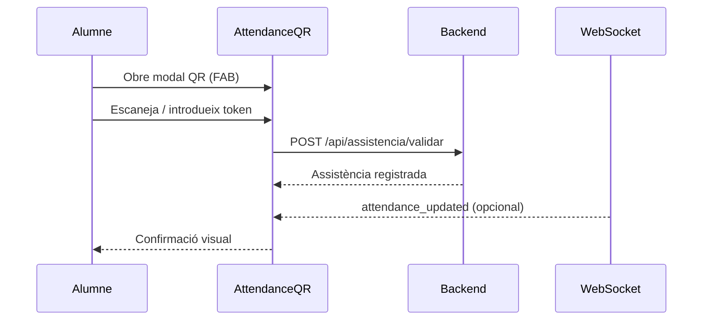
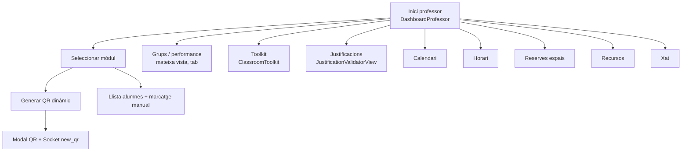
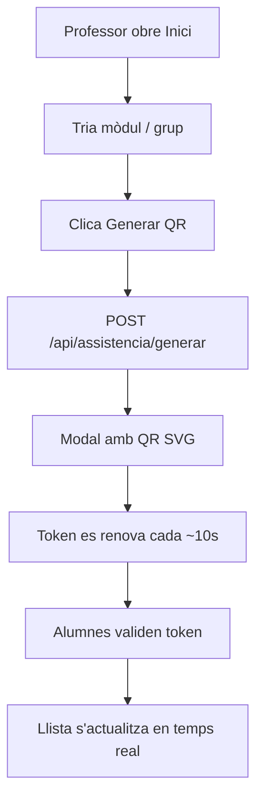
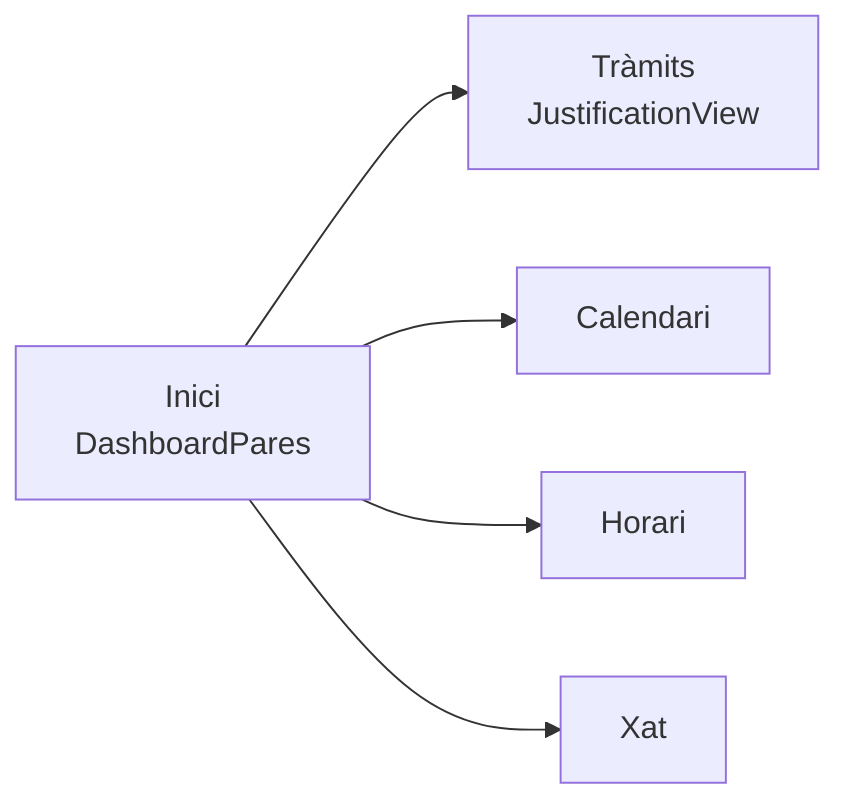
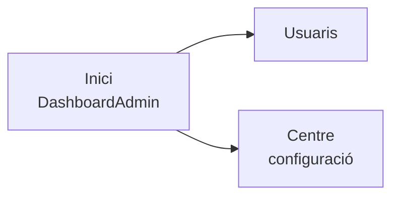
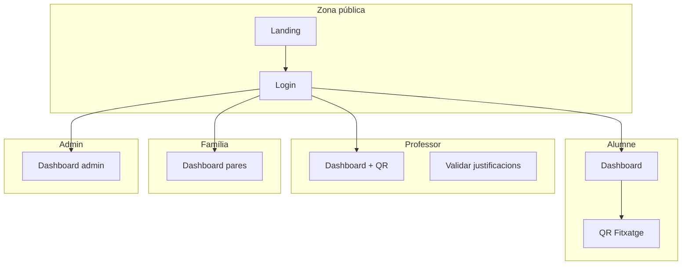

# Mockups i wireframes — Flux de pantalles

Documentació de l'**entrega de mockups/wireframes** del projecte ADSUM. Mostra el flux de navegació entre pantalles segons el rol de l'usuari, alineat amb la implementació actual (`App.vue`, `AppShell.vue`).

## Índex

1. [Flux global (no autenticat)](#1-flux-global-no-autenticat)
2. [Flux alumne](#2-flux-alumne)
3. [Flux professor](#3-flux-professor)
4. [Flux família](#4-flux-família)
5. [Flux administrador](#5-flux-administrador)
6. [Wireframes per pantalla](#6-wireframes-per-pantalla)
7. [Assets visuals](#7-assets-visuals)

---

## 1. Flux global (no autenticat)

Qualsevol visitant accedeix a l'aplicació sense sessió iniciada.



**Pantalles:**

| Pantalla | Fitxer | Descripció wireframe |
|----------|--------|----------------------|
| Landing | `LandingView.vue` | Hero, funcionalitats, rols, formulari registre centre |
| Login | `Login.vue` | Email, contrasenya, enllaç recuperació |

---

## 2. Flux alumne

Navegació principal via **sidebar / bottom nav** (`AppShell.vue`). Modal global: **QR de fitxatge** (FAB central al mòbil).



**Flux crític: fitxatge amb QR**



| `activeView` | Vista | Contingut principal |
|--------------|-------|---------------------|
| `home` | `DashboardBento` | Assistència %, mitjana, ratxa, QR identitat |
| `performance` | `PerformanceView` | Detall notes per mòdul |
| `calculator` | `CalculatorView` | Simulador mitjana |
| `justifications` | `JustificationView` | Pujar justificant + motiu |
| `calendar` | `CalendarView` | Esdeveniments escolars |
| `schedule` | `ScheduleView` | Horari setmanal |
| `booking` | `BookingView` | Reserva d'espais |
| `resources` | `RepositoriView` | Descàrrega de materials |
| `chat` | `ChatView` | Missatgeria per sales |
| `attendance` | `AttendanceStats` | Historial assistència |

---

## 3. Flux professor

El panell principal (`DashboardProfessor`) integra **tabs internes**: inici (QR + alumnes), rendiment grups (`performance`), eina d'aula (`toolkit`).



**Flux crític: passar llista amb QR**



| `activeView` | Vista | Funció |
|--------------|-------|--------|
| `home` | `DashboardProfessor` | QR, alumnes, comandament |
| `performance` | `DashboardProfessor` (tab) | Mètriques per grup |
| `toolkit` | `DashboardProfessor` (tab) | Grups aleatoris, eines |
| `justifications` | `JustificationValidatorView` | Validar / rebutjar |
| `calendar` | `CalendarView` | Calendari |
| `schedule` | `ScheduleView` | Horari |
| `booking` | `BookingView` | Reserves |
| `resources` | `RepositoriView` | Recursos |
| `chat` | `ChatView` | Xat |

---

## 4. Flux família

Rol `pare` a `AppShell.vue` (família vinculada a un alumne).



| Pantalla | Descripció |
|----------|------------|
| `DashboardPares` | Resum assistència i alertes del fill/a |
| `JustificationView` | Justificar faltes (upload) |
| `CalendarView` / `ScheduleView` | Seguiment acadèmic |
| `ChatView` | Comunicació (si habilitat) |

---

## 5. Flux administrador



| `activeView` | Funció |
|--------------|--------|
| `home` | Panell resum centre |
| `users` | Gestió usuaris |
| `center` | Configuració global (retards, absències) |

---

## 6. Wireframes per pantalla

Descripció de baixa fidelitat (wireframe textual) de les pantalles clau. Les captures reals es poden afegir a `doc/mockups/`.

### 6.1 Landing (pública)

```
+--------------------------------------------------+
|  [Logo] ADSUM          Funcionalitats | Accedir  |
+--------------------------------------------------+
|  Hero: "L'assistència, simplificada"             |
|  [Comença ara]  [Saber-ne més]                   |
|                    +------------------+          |
|                    | Mockup dashboard |          |
|                    +------------------+          |
+--------------------------------------------------+
|  3 columnes: QR | Agenda | Analítica             |
+--------------------------------------------------+
```

### 6.2 Login

```
+--------------------------------+
|         ADSUM                  |
|    Campus Digital · Institut   |
|  +------------------------+    |
|  | Correu institucional   |    |
|  +------------------------+    |
|  | Contrasenya            |    |
|  +------------------------+    |
|  [ Entrar ]                    |
+--------------------------------+
```

### 6.3 Dashboard alumne (Bento)

```
+------------------------------------------+
|  Bon dia, {nom}!    Curs 2025-26  En línia|
+------------------------------------------+
| [Assistència 92%] [Mitjana 7.8] [Ratxa]  |
| [QR identitat digital]                    |
+------------------------------------------+
|  Properes sessions / activitat recent     |
+------------------------------------------+
```

### 6.4 Dashboard professor — Modal QR

```
+--------------------------------+
|  {Nom mòdul}                   |
|  Escaneja per registrar...     |
|  +------------------------+  |
|  |                        |  |
|  |      [ QR CODE ]       |  |
|  |                        |  |
|  +------------------------+  |
|  ● Sincronitzat · canvia 10s |
+--------------------------------+
```

### 6.5 Modal QR alumne (FAB)

```
+--------------------------------+
|  Fitxatge ràpid                |
|  [ Camp token / escàner ]      |
|  [ Confirmar assistència ]     |
+--------------------------------+
```

---

## 7. Assets visuals

### Carpeta d'entrega

Pots afegir captures i mockups d'alta fidelitat a:

```
doc/mockups/
├── 01-landing.png
├── 02-login.png
├── 03-dashboard-alumne.png
├── 04-dashboard-professor-qr.png
├── 05-justificacions.png
└── README.md
```

### Referències al codi

| Mockup / captura | Origen al projecte |
|------------------|-------------------|
| Landing + hero | `frontend/src/views/LandingView.vue` |
| Mockup dashboard | `frontend/public/mockup_dashboard.png` (si disponible) |
| Login | `frontend/src/components/Login.vue` |
| Dashboard alumne | `frontend/src/views/DashboardBento.vue` |
| QR professor | `frontend/src/views/DashboardProfessor.vue` |

### Com generar captures per l'entrega

1. Executar frontend + backend en local.
2. Login amb rols de prova (`credenciales-prova.md`).
3. Capturar cada pantalla del flux anterior.
4. Desar PNG a `doc/mockups/` amb nomenclatura `NN-nom-pantalla.png`.

---

## Mapa complet de navegació



Veure també: [diagramas-uml-er.md](diagramas-uml-er.md) per diagrames UML i base de dades.
